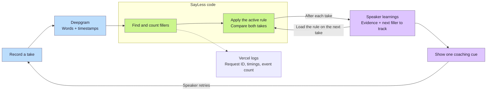

# Voice analysis architecture

**Status** Proposed for `feat/voice-analysis`.

The first milestone is one known mic recording in and a count backed by a clickable timeline out. A speaker should be able to click a counted “um” and hear it in the original take.

## Current behavior

The browser records one mic take and checks for audible input. `POST /api/practice` sends the audio for transcription and requests a coaching suggestion. Results calculate filler count and estimated pace from the transcript and recording duration. The results show aggregate counts and transcript text today.

## How the learning feeds back

On the first take, SayLess automatically chooses the most frequent filler that appears at least twice. If that is “um,” the learnings store the target and its baseline evidence. On the retry, the analyzer still counts every supported filler, and the saved rule tells the comparison to show “um: 3 → 1.” SayLess then uses the newest evidence to select the next focus. The same counting rules apply to every take.

## Proposed pipeline

1. **Capture and decode.** Keep the original recorded audio in browser memory for playback. Use elapsed time from the recording start as the shared clock for playback and analysis.
2. **Transcribe and measure audio in parallel.** Evaluate a transcription model that returns word timestamps and retains fillers. On the audio path, measure energy across short windows and flag sustained quiet gaps between speech segments. Exclude leading and trailing silence from the pause count while preserving offsets in the original recording.
3. **Normalize and emit events.** Keep the raw transcript for display. Normalize word tokens for matching and produce `{ kind, startMs, endMs, text? }` events for fillers and pauses. Use a `Map` to group filler events by word. Derive the replayable filler count from those events so it matches the timeline.
4. **Coach from evidence.** Give the model the transcript and measured events and ask for one actionable cue. Return the measurements and playback data if coaching fails. When word timestamps are unavailable, show the transcript and mark timestamped filler evidence as unavailable.
5. **Compare attempts.** Apply the same analysis to both takes and show each take’s duration next to its counts. Let the listener jump to a flagged event in the corresponding recording.

## First experiment

Use a short synthetic or consented fixture with known fillers, one deliberate pause, and room noise. Compare recognized fillers and event offsets with a hand-labeled timeline. Check a clean take and an all-silent take as well. Report which events were dropped or misaligned and how long a roughly 10-second recording took to process. The demo has about 10 seconds for processing before the presenter switches to sample replay.

The demo path uses one microphone, one fixed prompt, and two takes. Speaker attribution, system audio, realtime conversation, and long-term memory are follow-up work.
