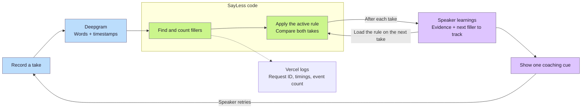

# Voice analysis architecture

**Status** Implemented on `feat/voice-analysis`. Real Deepgram validation requires a server-side `DEEPGRAM_API_KEY`.

The first milestone is one known mic recording in and a count backed by a clickable timeline out. A speaker should be able to click a counted “um” and hear it in the original take.

## Current behavior

The browser records one mic take and checks for audible input. [The practice API](voice-api.md) returns a transcript, optional filler events, and one coaching cue. The browser compares the latest two takes, keeps the source audio for replay, and carries each speaker’s next rule through the session. Two synthetic speaker profiles are available in Sample replay.

## How the learning feeds back

On the first take, SayLess automatically chooses the most frequent filler that appears at least twice. If that is “um,” the learnings store the target and its baseline evidence. On the retry, the analyzer still counts every supported filler, and the saved rule tells the comparison to show “um: 3 → 1.” SayLess then uses the newest evidence to select the next focus. The same counting rules apply to every take.

## Pipeline

1. **Capture.** Keep the original mic recording in browser memory. Use elapsed time from the audio start as the shared clock.
2. **Transcribe.** Send finished audio to Deepgram Nova-3 with English filler retention and read the word timestamps. Normalize “um” and “uh” in TypeScript and group the events with a `Map`.
3. **Apply and update.** Compare the previously selected target across the latest two timed takes. On each timed take, choose the most frequent filler appearing at least twice and use the first occurrence to break ties. Leave the rule unchanged when timestamps are unavailable.
4. **Coach and replay.** Generate one cue for the next focus, with a stock cue if coaching fails. Play a short clip from the original recording for each flagged event.

## First experiment

Use a short synthetic or consented fixture with known fillers and room noise. Compare recognized fillers and event offsets with a hand-labeled timeline. Check a clean take and an all-silent take as well. Report which events were dropped or misaligned and how long a roughly 10-second recording took to process. The demo has about 10 seconds for processing before the presenter switches to sample replay.

The demo path uses one microphone, one fixed prompt, and two takes. Audio-derived pauses, speaker attribution, system audio, realtime conversation, and long-term memory are follow-up work.
